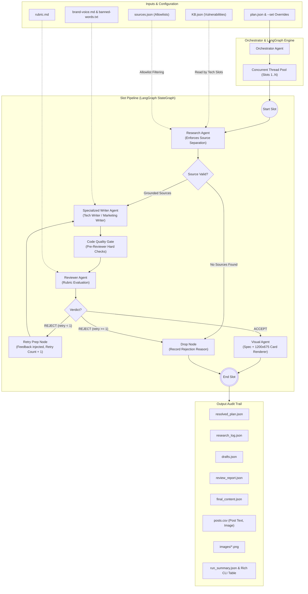

# Architecture: Multi-Agent Content Pipeline

SanadSquad Multi-Agent Content Pipeline engineered with **LangGraph**, **Gemini API**, **Tavily API**, and local **Ollama** (`qwen3.5:4b-q4_K_M`).

---

## 1. System Overview & Core Philosophy

The pipeline produces one week of verified, technically accurate, grounded X (Twitter) content for SanadSquad.

SanadSquad's positioning is unified:
> **"SanadSquad covers the whole attack surface, not just the contract."**
> Protocols get drained through compromised dev laptops, poisoned npm dependencies, hijacked frontends, or manipulated AI agents—not just Solidity contract bugs.

### Architectural Principles:
1. **Clear Roles & Clean Handoffs**: Specialized agents perform dedicated tasks without role bleed.
2. **Rules in Code, Judgement in the Model**: Mechanical checks (banned characters, AI vocabulary, syntactic patterns, hedging density, length limits, unretrieved links) are enforced strictly in deterministic Python code before model review.
3. **Instructions are Files, Not Strings**: Prompts and rubrics reside in separate markdown files (`instructions/`, `brand-voice.md`, `rubric.md`, `marketing-rules.md`). Modifying guidelines requires zero code refactoring.
4. **Strict Grounding & Traceability**: No invented facts. Every claim must trace back to `KB.json`, a fetched URL, or user input.
5. **Fault Isolation**: A failure or rejection in one slot never crashes the pipeline; other slots proceed concurrently.

---

## 2. Agent Graph & Data Flow Diagram

---

## 3. Agent Roles & Specifications

| Agent | Responsibility | Inputs | Permitted Sources | Tooling / Skills Used |
|---|---|---|---|---|
| **Orchestrator** | Loads plan, applies `--set` overrides, manages LangGraph execution across threads, tracks tokens/cost, exports audit trail. | `plan.json`, CLI flags | N/A | `concurrent.futures`, `rich`, CSV export |
| **Research Agent** | Resolves empty slots, queries KB or web search, enforces separation in code. | Slot focus & type | `tech-thread`: `KB.json` or technical URL. `marketing-post`: Web research only (domain allowlist). | `skills/kb_search.py`, `skills/web_search.py` |
| **Tech Writer Agent** | Drafts 5–10 tweet technical threads explaining smart contract bugs, exploit vectors, and remediations. | KB finding or tech URL | `KB.json` finding ID or verified tech URL | `instructions/tech_writer.md`, `brand-voice.md` |
| **Marketing Writer Agent** | Drafts single grounded marketing post (<= 280 chars) highlighting full attack surface. | Web search context | Allowed domains in `sources.json` for service | `instructions/marketing_writer.md`, `marketing-rules.md` |
| **Reviewer Agent** | Evaluates piece against written rubric; provides structured verdict, score, and actionable feedback. | Draft + Code Quality result | `rubric.md`, `brand-voice.md` | `instructions/reviewer.md` |
| **Visual Agent** | Generates image spec and renders branded 1200x675 X card for accepted pieces. | Accepted slot content | Internal metadata | `skills/image_prompt_builder.py` (Pillow) |

---

## 4. Reusable Skills

Skills are modular, reusable libraries adhering to clean single-responsibility principles:
1. `skills/kb_search.py`: Knowledge base indexer and search engine. **Shared by Research Agent and Tech Writer Agent**.
2. `skills/image_prompt_builder.py`: Visual prompt designer and Pillow 1200x675 card renderer. **Used by the Visual Agent for provenance labels, alignment validation, and rendering**.
3. `skills/web_search.py`: Tavily search integration with domain filtering, denylist enforcement, query logging, and verified offline fixtures.
4. `skills/quality_checker.py`: Code-level quality gate executing prior to model review.

---

## 5. Why Code Instead of the Model?

Prompting models to follow negative constraints ("do not use em dashes", "keep under 280 characters", "do not use words like delve") is notoriously non-deterministic. Models often violate formatting and character constraints under edge cases.

We enforce these checks in pure Python code:
1. **Banned Characters**: Em dashes (`—`), en dash separators (` – `), curly quotes (`“”‘’`), emojis, and hashtags (`#`) are detected via regex and rejected.
2. **Banned Vocabulary**: Loaded from `banned-words.txt` dynamically.
3. **Banned Syntactic Constructions**: Regex matching for negative parallelism (*"not just X, but Y"*), copula avoidance (*"serves as"*, *"stands as"*), and filler openers (*"In today's fast-paced world"*).
4. **Rule of Three**: Sentences with repeated parallel triples are detected algorithmically.
5. **Hedging Density**: Exact ratio calculation of modal/qualifying words per 100 words against a strict threshold (<= 2.0).
6. **Sentence Length Variance**: Statistical variance of sentence word counts is logged to monitor monotonous AI cadence.
7. **Unretrieved Links**: All URLs in generated content are cross-referenced against the run's `research_log.json`. Any invented or hallucinated URL causes an immediate code rejection.

### Stance on Third-Party AI Detectors
As noted in the specifications, third-party AI detector APIs produce erratic false positives on authentic technical prose. Instead of relying on a third-party black box, our deterministic code gate detects and eliminates the exact linguistic markers that cause text to read as AI-generated.

---

## 6. Scaling to 15 Slots or a Second Platform

### Growing to 15+ Slots
1. **Dynamic Concurrency & Rate Limiting**: The LangGraph pipeline already runs through `ThreadPoolExecutor`. Scaling to 15+ slots requires introducing token bucket rate-limiting for external APIs (e.g., Tavily 5 QPS, Gemini RPM).
2. **Topic Deduplication & Cohesion**: An orchestrated vector memory or SQLite state store to check semantic similarity across all 15 slots, ensuring format and service line balance per the Weekly Mix guidelines.
3. **Batch Embedding Retrieval**: Grouping slots for batch research queries to minimize network overhead.

### Adding a Second Platform (e.g., LinkedIn or Farcaster)
1. **Platform Adapters**: Define platform-specific schemas and constraint profiles (`LinkedInProfile`, `FarcasterProfile`) specifying character limits, allowed formatting (e.g. bold unicode vs plain ASCII), and hashtag allowances.
2. **Shared Research & Core Draft**: The Research Agent and core finding synthesis remain identical; only the Writer instruction files and Code Quality Gate rules adapt to the destination platform.
3. **Multi-Format Visual Agent**: Visual Agent renders 1:1 square cards for LinkedIn/Farcaster and 16:9 cards for X.

---

## 7. Known Limitations & Next Steps

### Known Limitations
1. **Local LLM Speed**: Ollama running locally (e.g. `qwen3.5:4b-q4_K_M`) on CPU/GPU can take 15–30 seconds per generation compared to Gemini API (~1–2s).
2. **Single-Sentence Markdown Formatting**: Local models occasionally wrap entire posts in quotation marks; handled via post-processing sanitizers.
3. **Explicit Demo Fixtures**: `--demo-research` opts into synthetic evidence labelled as fixtures. Demo pieces go only to preview exports. Live failures are logged and drop the affected research slot.

### Next Steps
1. **Automated Social Scheduling**: Direct integration with Typefully or Buffer APIs via webhook.
2. **Multi-Turn Reviewer Dialogue**: Allow 2-way iterative critique between Reviewer and Writer for complex vulnerability explanations.
3. **Fine-Tuned Evaluator**: Train a specialized small classifier on historical engagement data to predict tweet resonance.

## Audit fixes and execution ownership

`Orchestrator` creates `PipelineServices` for every run. Research logs, retrieved URLs, KB reservations, writers/reviewer configuration, and the thread-safe token tracker belong to that run. Explicit KB topics are reserved before parallel blank-slot allocation. The graph does not execute against process-global agent singletons, and importing a graph no longer constructs an orchestrator.

Each write creates a `DraftAttempt` before calling the model. Raw and processed drafts, code-quality metrics, reviewer verdicts, feedback, and failures remain in the exported history. Review parsing is strict and rejects invalid responses; deterministic failures cannot be overridden by a model acceptance. Complete overlong drafts go through the existing single rewrite loop rather than truncation.

Research logs distinguish live retrieval from demo fixtures, record the actual domain batch, and preserve errors and zero-result outcomes. URL checks use parsed hostnames and full normalized document URLs. Structured model response blocks are extracted as text without Python container representations. Token/cost summaries record effective provider/model and pricing completeness.

The visual specification derives its takeaway from accepted text and uses `KB FINDING`, `WEB RESEARCH`, `DEMO FIXTURE`, or `RESEARCH NOTE` according to provenance. A deterministic alignment check runs before rendering. It does not claim that every graphic represents a verified audit.

Output filenames are validated and resolved inside the chosen directory. Atomic JSON/CSV replacement and a run manifest make export completion explicit. Managed per-post/image artifacts are reconciled on reruns, including planned paths from failed runs. This is file-level atomic replacement, not a transaction across all artifacts: consumers must require `artifact_manifest.json` status `complete`. The output lock prevents overlapping runs from writing to the same directory.
