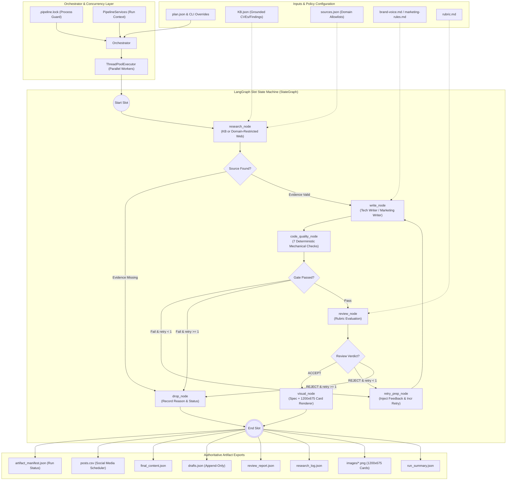
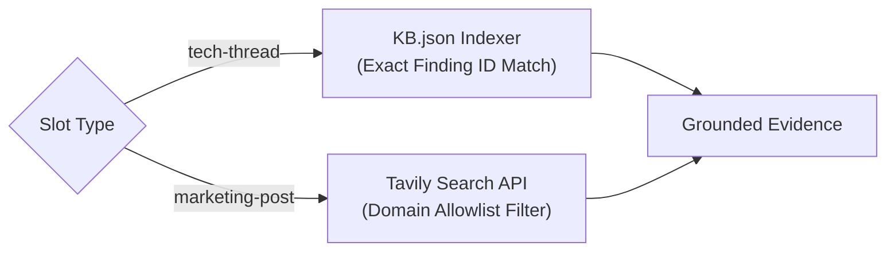

# Architecture: Multi-Agent Content Pipeline

High-assurance content pipeline for **SanadSquad** engineered with **LangGraph**, **Ollama** (`qwen3.5:4b-q4_K_M`), **Google Gemini API**, and **Tavily API**.

---

## 1. System Overview & Core Philosophy

The SanadSquad Content Pipeline produces one week of verified, technically accurate, grounded X (Twitter) content covering the complete enterprise and Web3 cybersecurity attack surface.

SanadSquad operates on a foundational security principle:
> **"SanadSquad covers the whole attack surface, not just the contract."**
> Protocols are routinely drained through compromised developer machines, malicious dependency updates (npm/PyPI), hijacked DNS/frontends, or manipulated autonomous AI agents—not merely Solidity smart contract vulnerabilities.

### Key Architectural Tenets:
1. **Separation of Concerns & Role Isolation**: Each agent has an unambiguous responsibility boundary. Research never drafts content; Writers never review their own output; Reviewers never invent new facts.
2. **Rules in Code, Judgment in the Model**: Negative constraints (banned vocabulary, forbidden characters, syntactical tropes, length boundaries, unretrieved URLs) are validated deterministically in Python code *before* calling the LLM reviewer.
3. **Instructions are Files, Not Strings**: System prompts and rubrics reside strictly in markdown files (`instructions/`, `brand-voice.md`, `rubric.md`, `marketing-rules.md`). Prompt adjustments require zero code refactoring.
4. **Strict Grounding & Provenance Traceability**: No fabricated facts or ungrounded claims. Every statement is directly anchored to `KB.json`, an explicit retrieved document from an allowed domain, or user input.
5. **Fault Isolation Across Slots**: Slots execute in parallel worker threads. A failure or rejection in one slot never interrupts or corrupts neighboring slots.
6. **Ephemeral Run-Scoped State**: All research logs, query batches, retrieved URLs, and token counts are scoped to an ephemeral `PipelineServices` context instantiated per run, preventing memory leaks and state pollution.

---

## 2. System Architecture & LangGraph State Machine



---

## 3. Agent Specifications & Responsibilities

| Agent / Node | Primary Responsibility | Input Context | Permitted Data Sources | Output Contract |
|---|---|---|---|---|
| **Orchestrator** | Coordinates weekly plan, validates slot IDs, manages thread pool, enforces lock, reconciles exports. | `plan.json`, CLI args | System filesystem | `artifact_manifest.json`, `posts.csv`, atomic JSON files |
| **Research Agent** | Gathers authoritative technical or industry evidence for empty or ungrounded slots. | Slot topic & service | `tech-thread`: `KB.json`<br>`marketing-post`: `sources.json` domains | `ResearchSource` (URL, excerpt, finding ID, provenance) |
| **Tech Writer Agent** | Drafts comprehensive 5-10 tweet educational threads explaining exploits and remediations. | KB finding or tech URL | `instructions/tech_writer.md`, `brand-voice.md`, finding details | List of tweet strings (<= 280 chars each, grounded in code) |
| **Marketing Writer Agent** | Drafts punchy, concise standalone marketing posts covering the complete attack surface. | Allowed web research | `instructions/marketing_writer.md`, `marketing-rules.md`, research text | Single post text (<= 280 chars, zero fluff) |
| **Code Quality Gate** | Validates 7 deterministic rules in pure Python before invoking model reviewer. | Raw draft text & URLs | `banned-words.txt`, `research_log.json` | `CodeQualityResult` (pass/fail, metric details, violations) |
| **Reviewer Agent** | Evaluates drafted piece against rubric, checks tone, logic, technical precision. | Draft + Gate results | `instructions/reviewer.md`, `rubric.md`, `brand-voice.md` | `ReviewVerdict` (ACCEPT/REJECT, score 1-10, feedback) |
| **Visual Agent** | Generates visual specification and renders branded 1200x675 PNG image cards. | Accepted post text | Provenance metadata | High-res PNG image saved to `images/<slot_id>.png` |

---

## 4. LangGraph State Schema (`SlotPipelineGraphState`)

The pipeline represents slot execution through a strongly-typed Pydantic state dictionary:

```python
class SlotPipelineGraphState(TypedDict):
    slot: Slot                          # Input slot definition
    research_sources: List[Dict]        # Grounding evidence & URLs
    draft: Optional[DraftContent]       # Current drafted content
    draft_history: List[DraftAttempt]   # Append-only chronological attempts
    code_quality_passed: bool           # Pre-review gate outcome
    code_quality_metrics: Dict          # Exact regex & statistical metrics
    review_verdict: Optional[str]       # ACCEPT or REJECT
    review_score: Optional[float]       # Numeric score (1.0 to 10.0)
    review_feedback: Optional[str]      # Specific revision instructions
    retry_count: int                    # Current retry index (max 1)
    visual_spec: Optional[VisualSpec]   # Generated image metadata
    image_path: Optional[str]           # Saved local PNG path
    status: str                         # "shipped", "dropped", or "demo"
    drop_reason: Optional[str]          # Failure diagnostic if dropped
    services: PipelineServices          # Ephemeral run services reference
```

### State Transitions & Edge Conditions:
1. `research_node` $\rightarrow$ `write_node`: If evidence is retrieved.
2. `research_node` $\rightarrow$ `drop_node`: If evidence retrieval failed or query returned 0 valid items.
3. `write_node` $\rightarrow$ `code_quality_node`: Immediately upon draft generation.
4. `code_quality_node` $\rightarrow$ `review_node`: If all 7 deterministic checks pass.
5. `code_quality_node` $\rightarrow$ `retry_prep_node`: If gate fails and `retry_count == 0`.
6. `code_quality_node` $\rightarrow$ `drop_node`: If gate fails and `retry_count >= 1`.
7. `review_node` $\rightarrow$ `visual_node`: If reviewer responds `ACCEPT`.
8. `review_node` $\rightarrow$ `retry_prep_node`: If reviewer responds `REJECT` and `retry_count == 0`.
9. `review_node` $\rightarrow$ `drop_node`: If reviewer responds `REJECT` and `retry_count >= 1`, or returns unparseable output.

---

## 5. Deterministic Code Gates vs. Stochastic AI Detectors

Prompting large language models with negative rules (*"Do not use words like 'pivotal'"*, *"Do not use em dashes"*, *"Keep under 280 characters"*) is fundamentally unreliable. Models frequently hallucinate compliance or violate rules under edge cases.

Similarly, third-party commercial "AI detector" APIs produce erratic false positives on authentic technical prose.

### The SanadSquad Deterministic Gate:
All mechanical constraints are enforced through pure Python algorithms in `skills/quality_checker.py`:

1. **Banned Characters & Punctuation**:
   Regex detection for em dashes (`—`), en dashes (` – `), curly quotes (`“”‘’`), emojis (`[\U00010000-\U0010ffff]`), and hashtags (`#`).
2. **Banned Vocabulary**:
   Case-insensitive word boundary regex matching against prohibited terms loaded dynamically from `banned-words.txt` (e.g. *delve*, *pivotal*, *testament*, *harness*, *crucial*).
3. **Banned Syntactic Patterns**:
   Regex flagging overused formulaic AI phrasing:
   - Negative parallelism (*"not just X, but Y"*)
   - Copula avoidance (*"stands as"*, *"serves as"*)
   - Filler openers (*"In the rapidly evolving world of..."*)
4. **Rule of Three**:
   Grammatical regex identifying repetitive triads (*"X, Y, and Z"*).
5. **Hedging Density Threshold**:
   Calculates ratio of qualifiers per 100 words (threshold $\le 2.0$):
   $$\text{Hedging Ratio} = \frac{\text{Count}(\text{qualifiers})}{\text{Total Words}} \times 100$$
6. **Cadence Variance**:
   Computes sample standard deviation of sentence word lengths to reject monotonous, repetitive AI cadences:
   $$\sigma = \sqrt{\frac{1}{N-1} \sum_{i=1}^N (L_i - \bar{L})^2} \ge 3.0$$
7. **Zero-Hallucination URL Verification**:
   Extracts all HTTP/HTTPS links from drafts and compares normalized document URLs against `research_log.json`. Any URL not in the retrieved set fails the gate immediately.

---

## 6. Grounding, Provenance & Source Separation

The system strictly isolates data sources based on slot type:



### Domain Allowlists & Strict URL Normalization:
- **Allowlist Enforcement**: Each service line (`web3`, `web2`, `agentic-security`, `payment-protocols`) defines approved domains in `sources.json`.
- **Hostname Parsing**: Uses `urllib.parse.urlsplit` to validate hostnames, strip port numbers, reject embedded user credentials (e.g. `user:pass@host`), and enforce HTTPS.
- **Honest Search Failure**: If Tavily returns zero usable results or credentials are invalid, the search fails honestly and logs the error. Synthetic fixtures are never substituted in live mode.
- **Explicit Demo Mode**: When `--demo-research` is explicitly passed, fixtures are loaded and tagged with `DEMO FIXTURE` provenance. Demo pieces are quarantined to `demo_content.json` and excluded from publication exports.

---

## 7. Storage, Locking & Atomic Manifest Protocol

### Concurrent Run Protection (`.pipeline.lock`):
To prevent simultaneous executions from corrupting output directories, the orchestrator acquires a directory lock:
- Creates `.pipeline.lock` containing the active Process ID (`PID`) and UTC timestamp.
- On rerun, verifies whether the recorded PID is currently alive on the host OS. Stale locks from crashed processes can be safely reclaimed.

### Atomic File Replacement:
- Artifacts (`posts.json`, `posts.csv`, `final_content.json`, `drafts.json`, etc.) are written to temporary files (`.tmp`) and replaced atomically using OS-level atomic rename operations.
- Re-running the pipeline reconciles managed files: previously generated posts and images for dropped or renamed slots are purged, while unrelated user files in the output directory are preserved.

### Authoritative Manifest (`artifact_manifest.json`):
Consumers of the pipeline must check `artifact_manifest.json` for status `"complete"` before publishing content. An incomplete or failed run is flagged explicitly in the manifest.

---

## 8. Extensibility & Future Scaling

### Scaling to 15+ Weekly Slots:
1. **Token Bucket Rate Limiting**: Integrate client-side rate limiters (e.g. 5 QPS for Tavily, 60 RPM for Gemini) to support high-concurrency plan execution without hitting provider rate limits.
2. **Semantic Slot Cohesion**: Introduce a shared vector store (e.g. ChromaDB or SQLite-vec) to evaluate cross-slot semantic novelty and maintain topic diversity across the weekly plan.

### Multi-Platform Adaptation (LinkedIn, Farcaster, Telegram):
1. **Platform Profile Contracts**: Define target constraints (`LinkedInProfile`, `FarcasterProfile`) adjusting character limits, hashtag permissions, and code block formatting.
2. **Adaptive Visual Renderer**: Configure `VisualAgent` to export 1:1 aspect ratio cards for LinkedIn/Farcaster and 16:9 cards for X.
