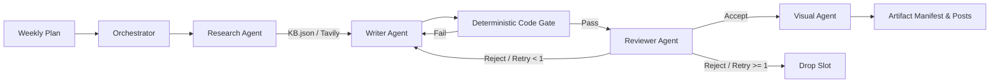

# Multi-Agent Content Pipeline

Production-grade content generation and verification pipeline for **SanadSquad**, engineered with **LangGraph**, **Ollama** (`qwen3.5:4b-q4_K_M`), **Google Gemini API**, and **Tavily API**.

[](tests/)
[](requirements-lock.txt)
[](graph/pipeline.py)
[](PIPELINE_AUDIT_REPORT.md)

---

## Table of Contents

- [Overview](#overview)
- [Repository Structure](#repository-structure)
- [Core Architecture & Capabilities](#core-architecture--capabilities)
- [Audit Findings & Hardening (21/21 Resolved)](#audit-findings--hardening-2121-resolved)
- [Setup & Installation](#setup--installation)
  - [1. Prerequisites](#1-prerequisites)
  - [2. Virtual Environment & Dependencies](#2-virtual-environment--dependencies)
  - [3. Environment Configuration](#3-environment-configuration)
  - [4. Local Ollama Model Setup](#4-local-ollama-model-setup)
- [CLI Usage & Workflows](#cli-usage--workflows)
  - [1. Full Weekly Pipeline (`run_week.py`)](#1-full-weekly-pipeline-run_weekpy)
  - [2. Single Piece Execution (`run_piece.py`)](#2-single-piece-execution-run_piecepy)
- [Deterministic Code Quality Gates](#deterministic-code-quality-gates)
- [Output Artifacts & Manifest Trail](#output-artifacts--manifest-trail)
- [Offline Verification & Testing](#offline-verification--testing)
- [License & Security](#license--security)

---

## Overview

SanadSquad delivers full-surface cybersecurity across four core verticals:

1. **Web3 Security** (EVM & Solana / SVM contract audits, formal invariant verification)
2. **Web2 Pentesting** (APIs, cloud infrastructure, CI/CD pipelines, frontends, dependency supply chains)
3. **Agentic Security & Red Teaming** (Prompt injection, tool abuse, agent wallets & spending policies)
4. **Agentic Payment Protocols** (x402 & MPP integration, facilitator trust models)

This pipeline generates one week of publish-ready, grounded X (Twitter) content by coordinating specialized agents in a deterministic **LangGraph** state machine. It prevents hallucinated claims, enforces brand voice and technical accuracy, runs pre-review deterministic code gates, gates publication with automated feedback loops, and renders branded 1200x675 visual cards.

---

## Repository Structure

```text
Multi-Agent-Content-Pipeline-with-langgraph/
├── .env.example               # Clean configuration template for credentials
├── .gitattributes             # Git normalization attributes
├── .gitignore                 # Excludes .venv/, .env, caches, runtime locks, and outputs
├── ARCHITECTURE.md            # In-depth system architecture & data flow diagrams
├── PIPELINE_AUDIT_REPORT.md   # Complete report of all 21 resolved architectural defects
├── README.md                  # Project overview, installation, CLI usage & audit docs
├── requirements.txt           # Minimal direct dependencies
├── requirements-lock.txt      # Fully pinned, reproducible Python 3.12 environment
├── plan.json                  # Weekly schedule (slot IDs, content types, topics, services)
├── KB.json                    # Grounded vulnerability knowledge base (CVEs, exploits, remediations)
├── sources.json               # Domain allowlists/denylists for web research per service line
├── brand-voice.md             # Editorial guidelines, tone of voice, and stylistic rules
├── marketing-rules.md         # Content rules, structure requirements, and hooks
├── banned-words.txt           # Prohibited AI buzzwords and corporate jargon
├── rubric.md                  # Reviewer evaluation rubric and scoring criteria
├── run_week.py                # CLI entrypoint for running the full weekly pipeline
├── run_piece.py               # CLI entrypoint for testing/generating a single slot
├── agents/                    # Specialized agent implementations
│   ├── orchestrator.py        # Schedule manager, thread pool, and artifact exporter
│   ├── research_agent.py      # Grounding engine for KB lookup and web search
│   ├── tech_writer.py         # Multi-tweet technical thread author (5-10 tweets)
│   ├── marketing_writer.py    # Standalone marketing post author (<= 280 chars)
│   ├── reviewer_agent.py      # Editorial quality gate evaluating against rubric.md
│   ├── visual_agent.py        # Card specification generator and provenance tagger
│   └── llm_factory.py         # Multi-provider LLM builder (Gemini API & local Ollama)
├── config/
│   └── settings.py            # Pydantic environment settings, API keys, and model configs
├── graph/
│   └── pipeline.py            # LangGraph StateGraph definition for slot execution
├── instructions/              # Markdown system prompts injected into agent contexts
│   ├── tech_writer.md
│   ├── marketing_writer.md
│   └── reviewer.md
├── models/
│   ├── schemas.py             # Pydantic data schemas (Slot, DraftAttempt, ReviewVerdict, etc.)
│   └── paths.py               # Path helpers and directory resolution
├── skills/                    # Reusable tools and verification modules
│   ├── kb_search.py           # Indexed knowledge base search with exact ID lookup
│   ├── web_search.py          # Tavily search integration with domain filtering & batching
│   ├── quality_checker.py     # Deterministic code-level checks (regex, variance, URLs)
│   └── image_prompt_builder.py# Branded 1200x675 PNG image renderer (Pillow)
├── tests/                     # 100% offline regression and unit test suite (88 tests)
│   ├── test_pipeline.py       # LangGraph state machine, retry loop, and drop handling
│   ├── test_quality.py        # Deterministic quality gate and regex validator checks
│   ├── test_research.py       # Source separation, allowlists, and KB lookup
│   └── test_runtime.py        # Plan validation, path traversal prevention, and atomic exports
└── output/                    # Local run output directory (contains .gitkeep)
```

---

## Core Architecture & Capabilities



1. **Dual LLM Provider Support**: Runs on local hardware via **Ollama** (`qwen3.5:4b-q4_K_M`) with zero API costs, or in the cloud using **Google Gemini** (`gemini-2.5-flash`).
2. **Strict Source Separation**:
   - `tech-thread`: Exclusively queries `KB.json` finding IDs or technical CVE/exploit documentation.
   - `marketing-post`: Restricted to approved web domains defined in `sources.json` per service category.
3. **Deterministic Code Quality Gates**: 7 mechanical checks run in pure Python *before* calling the LLM reviewer, eliminating AI vocabulary, banned punctuation, overused syntax, and unretrieved URLs.
4. **Resilient Feedback Loops**: When an initial draft fails quality checks or rubric scoring, the writer receives structured critique and exactly one revision opportunity before being dropped.
5. **Branded Visual Card Generation**: Accepted pieces automatically receive a 1200x675 pixel PNG card rendered with Pillow, complete with provenance tags (`KB FINDING`, `WEB RESEARCH`, `DEMO FIXTURE`).
6. **Isolated State Execution**: Each run instantiates an isolated `PipelineServices` context, guaranteeing thread safety, independent token accounting, and zero cross-run state pollution.

## Setup & Installation

### 1. Prerequisites

- **Python**: 3.10+ (Tested extensively on Python 3.12 64-bit on Windows, Linux, and macOS)
- **Git**: Installed and configured
- **Ollama** *(Optional, for local inference)*: Download from [ollama.com](https://ollama.com/)

### 2. Virtual Environment & Dependencies

```powershell
# Clone the repository
git clone https://github.com/mina-fady1/Multi-Agent-Content-Pipeline-with-langgraph.git
cd Multi-Agent-Content-Pipeline-with-langgraph

# Create virtual environment
python -m venv .venv

# Activate virtual environment
# Windows PowerShell:
.\.venv\Scripts\Activate.ps1
# Linux / macOS:
# source .venv/bin/activate

# Install dependencies (pinned lock file recommended for reproducibility)
python -m pip install -r requirements-lock.txt
```

### 3. Environment Configuration

Copy the clean template `.env.example` to `.env`:

```powershell
cp .env.example .env
```

Configure your environment variables in `.env`:

```env
# Google Gemini API Key (Required when using --provider gemini)
GEMINI_API_KEY=your_gemini_api_key_here

# Tavily Search API Key (Required for live web research)
TAVILY_API_KEY=your_tavily_api_key_here

# Default Provider: 'ollama' or 'gemini'
LLM_PROVIDER=ollama

# Model Configurations
GEMINI_MODEL=gemini-2.5-flash
OLLAMA_MODEL=qwen3.5:4b-q4_K_M
OLLAMA_BASE_URL=http://localhost:11434
```

> [!IMPORTANT]
> The `.env` file is excluded in `.gitignore` to guarantee secret credentials are never committed.

### 4. Local Ollama Model Setup

To run 100% locally with zero cloud API keys:

```powershell
# Start Ollama service (if not running as a system service)
ollama serve

# Pull the verified local model
ollama pull qwen3.5:4b-q4_K_M
```

---

## CLI Usage & Workflows

### 1. Full Weekly Pipeline (`run_week.py`)

Executes the scheduled slots defined in `plan.json` in parallel:

```powershell
# 1. Run with local Ollama (zero API costs)
python run_week.py --provider ollama --output output/week

# 2. Run with Google Gemini API
python run_week.py --provider gemini --model gemini-2.5-flash --output output/week

# 3. Override a topic dynamically on the command line
python run_week.py --plan plan.json --set thread_2="oracle manipulation"

# 4. Run in offline demo mode using fixture research
python run_week.py --provider ollama --demo-research --output output/demo
```

### 2. Single Piece Execution (`run_piece.py`)

Generates and verifies an individual piece for rapid iteration:

```powershell
# Generate a technical thread from a specific KB finding
python run_piece.py --type tech-thread --topic "SS-03699" --provider ollama

# Generate a technical thread on a general topic
python run_piece.py --type tech-thread --topic "reentrancy" --provider gemini

# Generate a standalone marketing post for Agentic Security
python run_piece.py --type marketing-post --topic "prompt injection" --service agentic-security --provider ollama
```

---

## Deterministic Code Quality Gates

Before any drafted piece is submitted to the LLM reviewer, it must pass 7 automated code-level checks in `skills/quality_checker.py`:

| Check | Target / Rule | Failure Condition |
| --- | --- | --- |
| **Banned Characters** | No em dashes (`—`), en dashes (` – `), curly quotes (`“”‘’`), emojis, or hashtags (`#`) | Any matching forbidden character |
| **Banned Vocabulary** | Loaded dynamically from `banned-words.txt` | Any prohibited buzzword (e.g. *delve*, *pivotal*, *testament*) |
| **Banned Syntactic Patterns** | Negative parallelism, copula avoidance (*serves as*), and filler openers | Matched syntax regex |
| **Rule of Three** | Overused parallel triples (*"X, Y, and Z"*) | Repeated three-item list structures |
| **Hedging Density** | Maximum 2.0 qualifiers per 100 words | Hedging ratio > 2.0 (e.g. *perhaps*, *arguably*, *might*) |
| **Sentence Length Variance** | Avoids monotonous robotic sentence cadence | Sentence length standard deviation < 3.0 |
| **URL Verification** | Zero unretrieved or hallucinated links | Any link not in `research_log.json` |

---

## Output Artifacts & Manifest Trail

Each run generates a comprehensive audit trail in its target directory:

```text
output/week/
├── artifact_manifest.json   # Authoritative run manifest with status ("complete" / "failed")
├── resolved_plan.json       # Plan mapping slots to resolved topics and sources
├── research_log.json        # Provenance log of all searched queries and retrieved URLs
├── drafts.json              # Full chronological attempt history with feedback
├── review_report.json       # Final reviewer scores, verdicts, and failure reasons
├── final_content.json       # Structured accepted pieces with image specifications
├── posts.csv                # Ready-to-schedule social media export (Post Text, Image)
├── run_summary.json         # Run metrics: shipped/dropped count, tokens, duration, cost
├── posts/                   # Per-slot JSON files for accepted pieces
└── images/                  # Branded 1200x675 visual cards rendered via Pillow
```

---

## Offline Verification & Testing

The project includes an extensive, offline-first regression test suite. All tests execute with mocked LLM and search calls, writing to isolated temporary directories:

```powershell
# Run the complete test suite (88 tests)
python -m unittest discover -s tests -v

# Verify clean package dependencies
python -m pip check
```

---

## License & Security

This repository is maintained for **SanadSquad**. All security research, vulnerability data in `KB.json`, and branded visual assets are protected.
